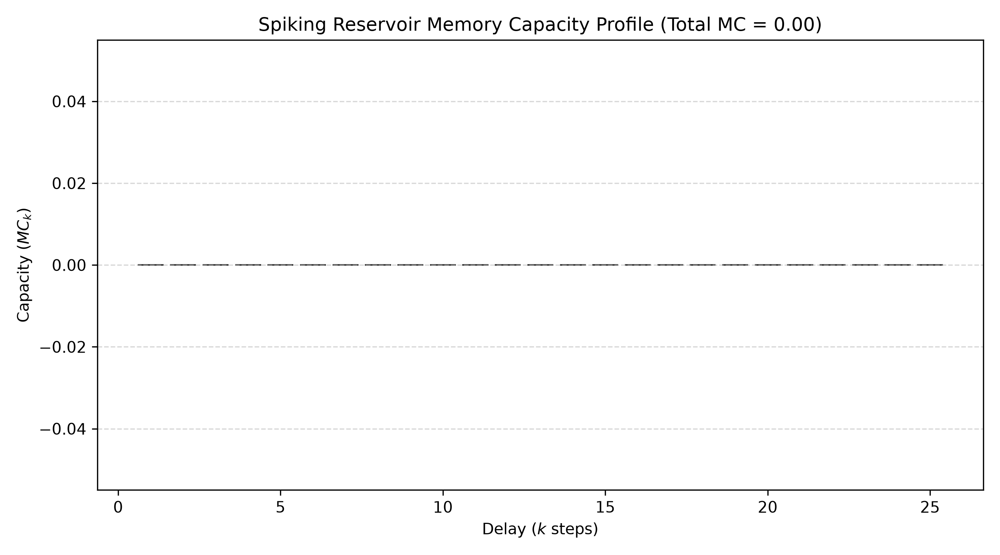

# Spiking Reservoir Memory Capacity (`lsm-03-memory-capacity`)

[](https://opensource.org/licenses/MIT)
[](https://www.python.org/)
[](https://brian2.readthedocs.io/)

> *Evaluating short-term memory performance and information processing capacity (Jaeger, 2002) in a spiking Leaky Integrate-and-Fire reservoir.*

---

## Overview



This project measures the temporal memory capacity of the spiking network by tasking linear readouts with reconstructing past input values $u(t-k)$ across increasing time delays $k$.

---

## Quick Execution

```bash
pip install -r requirements.txt
PYTHONPATH=. python3 scripts/run_experiment.py